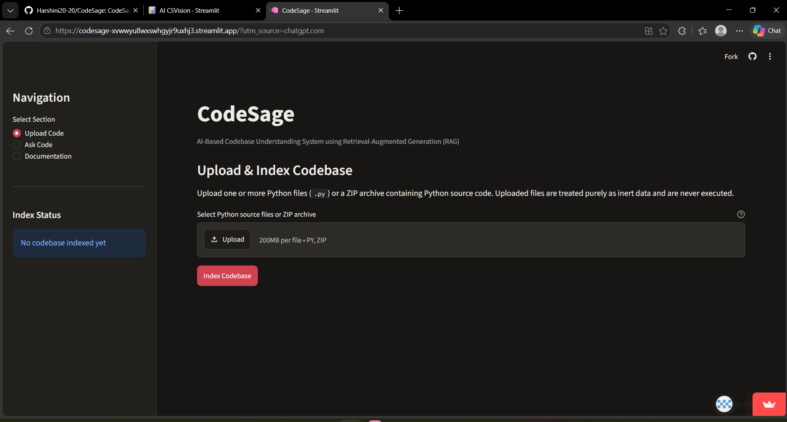

# CodeSage 🧠
### AI-Based Code Understanding System Using Retrieval-Augmented Generation (RAG)

<p align="center">
  An intelligent codebase understanding system that helps developers explore, retrieve, and understand unfamiliar Python codebases using Retrieval-Augmented Generation.
</p>

<p align="center">
  <a href="https://codesage-xvwwyu8wxswhgyjr9uxhj3.streamlit.app/">
    
  </a>
  <a href="https://github.com/Harshini20-20/CodeSage">
    
  </a>
  
  
</p>

---

## 📌 Project Overview

CodeSage is an AI-powered code understanding system developed to help developers understand unfamiliar codebases through natural-language interaction.

Traditional code exploration requires developers to manually navigate files, understand dependencies, and locate relevant functions or classes. Generic Large Language Models (LLMs) often lack access to the specific context of a developer's codebase.

CodeSage addresses this limitation through **Retrieval-Augmented Generation (RAG)**. It parses source code, generates meaningful code chunks, converts them into vector embeddings, and retrieves relevant context to generate grounded explanations using an open-source LLM through Ollama.

The system provides an interactive Streamlit interface for uploading codebases and querying their contents.

## 🎯 Problem Statement

Understanding large or unfamiliar codebases can be time-consuming and difficult. Developers often need to manually inspect multiple files to understand functions, classes, relationships, and implementation details.

Generic LLMs may generate explanations without having access to the actual source code, resulting in responses that lack codebase-specific context.

CodeSage aims to bridge this gap by combining structural code analysis, semantic retrieval, and LLM-based explanation generation.

## 🎯 Objectives

- Accept Python source files and ZIP archives containing codebases.
- Parse Python source code using Abstract Syntax Trees (AST).
- Divide source code into meaningful, structure-aware chunks.
- Generate semantic embeddings for code representations.
- Store and retrieve code chunks using a vector database.
- Retrieve relevant context based on natural-language queries.
- Generate codebase-specific explanations using an LLM.
- Provide an interactive interface for code exploration.

## ⚙️ System Architecture

```text
          Python Files / ZIP Archives
                     |
                     v
              Code Ingestion
                     |
                     v
                AST Parser
                     |
                     v
             Structure-Aware
                Chunking
                     |
                     v
           Embedding Generation
                     |
                     v
                ChromaDB
              Vector Storage
                     |
                     |
              User Question
                     |
                     v
             Query Embedding
                     |
                     v
           Context-Aware Retrieval
                     |
                     v
           Relevant Code Context
                     |
                     v
             RAG Pipeline
                     |
                     v
              Ollama LLM
                     |
                     v
          Context-Grounded Answer
                     |
                     v
             Streamlit Interface
```

## ✨ Key Features

### 1. Codebase Upload and Indexing
- Upload individual Python files.
- Upload ZIP archives containing Python source code.
- Extract and process source files.
- Index code into searchable chunks.
- Display indexing status and processed file information.
- Uploaded files are treated as data and are not executed.

### 2. AST-Based Code Parsing
- Uses Python's Abstract Syntax Tree (AST) module.
- Identifies structural elements in Python source code.
- Supports structure-aware code processing.

### 3. Structure-Aware Code Chunking
- Divides source code into meaningful chunks.
- Preserves code structure during processing.
- Prepares code representations for embedding generation and retrieval.

### 4. Semantic Code Retrieval
- Generates embeddings using Sentence Transformers.
- Stores vector representations in ChromaDB.
- Retrieves relevant code chunks using semantic similarity.
- Supports context-aware retrieval improvements introduced in Phase 2C.

### 5. LLM-Based Code Understanding
- Integrates Ollama for local LLM inference.
- Uses retrieved code context to support answer generation.
- Enables natural-language interaction with indexed codebases.

### 6. Interactive Streamlit Interface
- Codebase upload and indexing.
- Natural-language code queries.
- Interactive navigation.
- Documentation section.

## 🖥️ Application Screenshots

### Upload and Index Codebase

Upload Python source files or ZIP archives and index them for semantic retrieval.



### Ask Code

*Additional application screenshots will be added.*

## 🛠️ Technology Stack

| Component | Technology |
|---|---|
| Programming Language | Python |
| Frontend | Streamlit |
| Code Parsing | Python AST |
| Code Chunking | Custom structure-aware chunker |
| Embeddings | Sentence Transformers |
| Embedding Model | all-MiniLM-L6-v2 |
| Vector Database | ChromaDB |
| LLM Integration | Ollama |
| Local LLM | Llama 3.2 (3B) |
| Testing | Pytest |
| Version Control | Git and GitHub |

## 🏗️ Project Structure

```text
CodeSage/
│
├── app.py
├── config.py
├── requirements.txt
├── .env.example
├── .gitignore
│
├── src/
│   ├── parser.py
│   ├── chunker.py
│   ├── embedder.py
│   ├── vectordb.py
│   ├── retriever.py
│   ├── llm.py
│   ├── prompts.py
│   ├── rag_pipeline.py
│   └── utils.py
│
├── tests/
├── data/
├── chroma_db/
├── logs/
├── docs/
├── images/
│
└── README.md
```

## 🚀 Installation and Setup

### Prerequisites

- Python 3.12
- Git
- Ollama
- pip

### 1. Clone the Repository

```bash
git clone https://github.com/Harshini20-20/CodeSage.git
```

### 2. Navigate to the Project

```bash
cd CodeSage
```

### 3. Create a Virtual Environment

```bash
python -m venv venv
```

Activate on Windows:

```powershell
venv\Scripts\Activate.ps1
```

### 4. Install Dependencies

```bash
pip install -r requirements.txt
```

### 5. Configure Ollama

Install Ollama and download the local model:

```bash
ollama pull llama3.2:3b
```

Ensure the Ollama service is running.

The default local Ollama endpoint is:

```text
http://localhost:11434
```

The model and host can be configured through environment variables:

```env
CODESAGE_OLLAMA_MODEL=llama3.2:3b
CODESAGE_OLLAMA_HOST=http://localhost:11434
```

### 6. Run the Application

```bash
streamlit run app.py
```

### 7. Run Tests

```bash
python -m pytest
```

## 🧪 Testing and Development Progress

CodeSage was developed incrementally through multiple implementation phases.

| Milestone | Status |
|---|---|
| AST-based parsing | Completed |
| Structure-aware chunking | Completed |
| Embedding generation | Completed |
| Vector database integration | Completed |
| Semantic retrieval | Completed |
| Ollama integration | Completed |
| RAG pipeline | Completed |
| Streamlit interface | Completed |
| Context-aware retrieval (Phase 2C) | Completed |

### Phase 2C Testing Results

**323 tests passed in 71.89 seconds** at the Phase 2C development checkpoint.

Testing covers the implemented components and their integration.

## 🔐 Security Considerations

- Uploaded Python files are treated as source data and are never executed.
- Local Ollama inference can be used without external LLM API keys.
- Configuration values are managed separately from application code.
- Sensitive configuration files should not be committed to the repository.

## 🌐 Live Demo

Try the deployed application:

**[Launch CodeSage – Streamlit](https://codesage-xvwwyu8wxswhgyjr9uxhj3.streamlit.app/)**

For local development, configure Ollama and the required model on the host machine. The public deployment requires an inference service accessible from its hosting environment.

## 🔮 Future Scope

- Support for additional programming languages.
- Improved cross-file code understanding.
- Advanced dependency and relationship analysis.
- Enhanced retrieval and ranking strategies.
- More detailed source-level explanations.
- Expanded codebase analysis capabilities.

## 👩‍💻 Project Information

**Project:** CodeSage – AI-Based Code Understanding System Using RAG

**Project Type:** VTU Major Project

**Developer:** Harshini G

**GitHub:** [Harshini20-20](https://github.com/Harshini20-20)

---

<p align="center">
  Built with Python, Retrieval-Augmented Generation, and open-source AI technologies.
</p>
